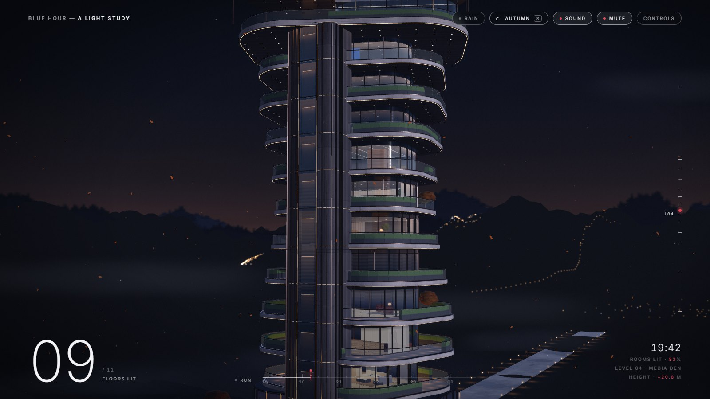
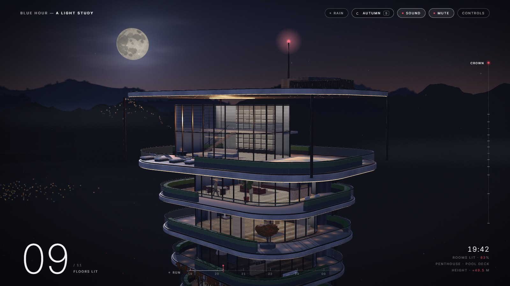
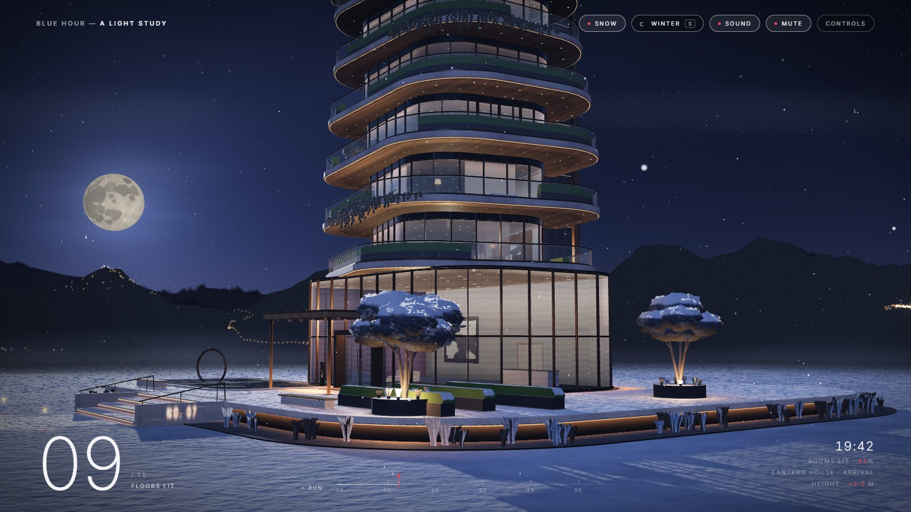
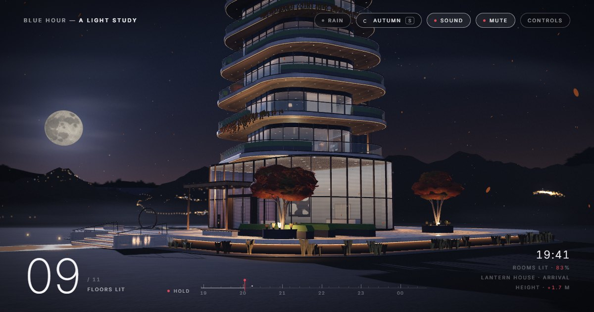

<h1 align="center">Blue Hour: A Light Study</h1>

<p align="center">
  An interactive WebGL study of one building at nightfall: a twisting residential tower<br />
  that switches on, floor by floor, as blue hour turns to night.
</p>

<p align="center">
  <a href="https://blue-hour-light-study.pages.dev"><b>Live demo</b></a> ·
  <a href="docs/CASE_STUDY.md"><b>Case study</b></a> ·
  <a href="docs/DESIGN.md">Design</a> ·
  <a href="docs/ARCHITECTURE.md">Architecture</a> ·
  <a href="docs/PERFORMANCE.md">Performance</a>
</p>

<!-- Season loop (Autumn → Winter → Spring → Summer, 14 s, 1080p H.264, 8.8 MB),
     made by `npm run record` into recordings/season-loop.mp4. -->

https://github.com/user-attachments/assets/adc5acfb-d9dc-42c2-81b0-fbe6781073f6

## About

**Lantern House** is a concept tower: eleven twisting white slabs over a glazed
lobby, ten furnished floors and a penthouse with a pool. The page opens at
18:56 with the house dark. As the sky deepens, the lobby switches on, then a
line of light rises up the lift shaft, the floors light from the bottom up,
and the aviation beacon comes on last. The evening then runs to 00:40, and
floors go dark as the residents turn in.

Light is the only thing that moves the story. The page has no copy beyond a
title, a clock and a count of lit floors.

Built for desktop browsers with a mouse or trackpad, in a window at least
1024 × 540. Smaller windows, phones and tablets get a one-line notice and
none of the scene.

## Highlights

- **One uniform switches a floor.** Every emitter is dimmed by a zone value
  chosen from its height, so coves, downlights, lamps, rooms and real lights
  on a floor change together. Scrub the evening on the time bar.
- **Traced interiors.** The rooms behind the glass are ray-traced boxes in a
  fragment shader that write real depth, so modelled furniture sits inside
  them. Ten floors, ten different homes, some with residents walking about.
- **Four seasons** as whole-scene states: sky, light, fog, foliage, bark,
  moon halo and particles. Autumn leaves litter the plinth; winter snow
  drifts over the lawn, hedges and tree crowns, and the pool freezes; spring
  blossom runs white to pink with petals under the trees and on the pool;
  summer crowns go dense and dark under a warm horizon haze.
- **Interaction:** drag to untwist the slabs on springs, scroll to fly a drone
  up the tower, click a window to switch that floor.
- **Sound:** a night field recording under synthesised rain, wind and a chime
  as each floor lights, on by default and started on the first click or key.
- **Fast:** textures painted in Web Workers, a time-sliced build, 965 meshes
  merged into 373, shadows drawn once, adaptive quality and an idle loop.

<table>
  <tr>
    <td></td>
    <td></td>
  </tr>
  <tr>
    <td></td>
    <td></td>
  </tr>
</table>

## Results

Production build in Chrome at 1440 × 900 on an RTX 5050 laptop, medians of
three runs. "Cold" is a first visit with no shader cache; "warm" is a repeat
visit. `npm run bench` reproduces these; methods are in
[PERFORMANCE.md](docs/PERFORMANCE.md).

| Metric                   | Result                                         |
| ------------------------ | ---------------------------------------------- |
| Scene on screen          | 2.7 s warm, 3.7 s cold                         |
| Total blocking time      | 168 ms warm, 416 ms cold                       |
| Longest main-thread task | 127 ms warm, 185 ms cold                       |
| CPU / GPU time per frame | 4.4 ms / 4.7 ms (16.7 ms is the 60 fps budget) |
| Draw calls per frame     | 348–787, from 965 meshes merged into 373       |

On a low-end integrated GPU (AMD Radeon 610M) adaptive quality settles at
50 fps on the arrival view and 74 fps in the drone flight. Played as a budget
laptop (that GPU, a CPU slowed threefold, 1366 × 768; `npm run bench:lowend`),
the intro runs at 26–37 fps, every interaction at 38–71 fps, and no input
waits more than 120 ms for a frame. The page loads and runs in WebKit,
Safari's engine (`npm run bench:webkit`).

Lighthouse (desktop, cold): Performance 73–77, Accessibility 100, Best
practices 100, SEO 100. Layout shift 0; first paint 0.5 s.

## Controls

| Input          | Action                                   |
| -------------- | ---------------------------------------- |
| Drag           | Untwist the tower                        |
| Shift-drag     | Orbit (right-drag works too)             |
| Scroll, ↑ / ↓  | Fly up and down the tower                |
| Click a window | Switch that floor's lights               |
| Space / R      | Pause or play / replay from blue hour    |
| Time bar       | Drag to any minute                       |
| S              | Next season (or click the season button) |
| P / M          | Light pattern / mute                     |
| ?              | Show every control                       |

Every animation respects `prefers-reduced-motion`.

## Run it locally

Requires Node.js 20 or newer.

```bash
npm install
```

```bash
npm run dev
```

| Script                 | What it does                                                          |
| ---------------------- | --------------------------------------------------------------------- |
| `npm run dev`          | Development server                                                    |
| `npm run build`        | Production build into `dist/`                                         |
| `npm run check`        | Lint, format check and build (what CI runs)                           |
| `npm run bench`        | Load and frame-cost benchmark of `dist/` in Chrome or Edge            |
| `npm run bench:lowend` | The scene played as a budget laptop: intro, interactions, input delay |
| `npm run bench:webkit` | The same load and CPU checks in WebKit (Safari's engine)              |
| `npm run capture`      | Regenerates the screenshots and social image from `dist/`             |
| `npm run record`       | Records the 14 s season loop from `dist/` as a 1080p MP4              |

Add `?debug` to the URL for build timings in the console. Deployment notes are
in [DEPLOYMENT.md](docs/DEPLOYMENT.md).

## Built with

[three.js](https://threejs.org) r170 and plain JavaScript modules, Web Workers
with OffscreenCanvas, the Web Audio API, [Vite](https://vite.dev), and
[Cloudflare Pages](https://pages.cloudflare.com).

## Procedural and scanned

Almost everything is made in code. Only three things come from outside:

| Scanned / recorded                                                  | Procedural (made in code)                                                |
| ------------------------------------------------------------------- | ------------------------------------------------------------------------ |
| Concrete pavers, oak veneer and cherry bark: Poly Haven photo scans | All geometry: tower, slabs, furniture, trees, terrain                    |
| Fascia relief and roughness (brushed concrete scan, no colour)      | Fascia weathering, leaf cards, foliage, fabric, stone and glass textures |
| Night ambience: a field recording                                   | Sky, moon, clouds, stars, seasons, snow, petals, rain, interiors, chimes |

## Credits

- Scanned textures (`src/assets/textures/*.webp`): [Poly Haven](https://polyhaven.com),
  CC0 1.0 ([details](src/assets/textures/README.md)).
- Night ambience: [BigSoundBank](https://bigsoundbank.com) #1880, CC0
  (trimmed to a 75-second mono loop).
- Typeface (`src/assets/fonts/inter-latin-var.woff2`): [Inter](https://rsms.me/inter/)
  by The Inter Project Authors, SIL Open Font License 1.1 (see
  [OFL.txt](src/assets/fonts/OFL.txt)).
- [three.js](https://threejs.org) (npm dependency): MIT.

Everything else (geometry, procedural textures, shaders, light, synthesised
sound and interface) is original to this project.

## License

Code is [MIT](LICENSE). Third-party assets keep their own licences.
