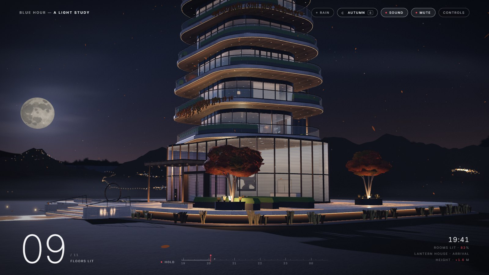

# Case study: Blue Hour, a light study

  

|              |                                                                                                                                     |
| ------------ | ----------------------------------------------------------------------------------------------------------------------------------- |
| **Role**     | Lighting and motion design, interface design, procedural 3D modelling, GLSL shaders, generative sound and performance engineering   |
| **Platform** | Desktop web, on the latest Chrome, Edge, Firefox and Safari                                                                         |
| **Stack**    | three.js (WebGL 2), custom GLSL shaders, the Web Audio API, Web Workers and Vite                                                    |
| **Links**    | [Live site](https://blue-hour-light-study.pages.dev) · [Source on GitHub](https://github.com/nishanthsr7-eng/blue-hour-light-study) |

## Overview

Architectural visualisation on the web usually means a model you can spin
around. I wanted to try the opposite: a page with almost no interface, where
**light tells the story** and the visitor watches a building come to life at
nightfall.

The result is an interactive study of one fictional tower, Lantern House. The
page opens at 18:56, at blue hour, with the house dark. Over a few seconds
the sky deepens and the house switches on, floor by floor. Visitors can then
scrub through the evening, fly up the tower, untwist it, change the season
or switch any floor's lights with a click.

<!-- FILL: one or two sentences on why you made it: what you wanted to learn
     or prove, or what inspired it (a photograph, a building, a film). -->

## The challenge

1. **Tell a story without words.** No copy, no onboarding, no navigation.
   The visitor should understand what is happening from light and motion
   alone.
2. **Make a heavy 3D scene feel calm.** Real-time 3D on the web tends to
   look busy and run hot. This one had to feel quiet and cinematic, and stay
   smooth on an ordinary laptop.
3. **Design an interface that stays out of the way.** Controls had to be
   there when wanted and invisible when not, without hiding what the piece
   can do.

## Design principles

I set these before designing anything, and used them to settle every
decision afterwards.

- **Light is the only thing that moves the story.** Every change in the
  scene is a change in light.
- **The house is the hero.** Sky, mountains and meadow stay darker, hazier
  and lower in contrast, so nothing competes with a lit window.
- **Instruments, not a website.** The interface reads like the controls on a
  camera or a drafting table: precise, small and quiet.
- **Motion has weight.** Things ease in and settle, as if they had mass.
  Nothing snaps.
- **Smoothness is part of the design.** A beautiful effect that stutters is
  a bug.

## Concept and narrative

Blue hour is the short window after sunset when the sky turns deep blue and
interior lights start to read against it. Architectural photographers wait
for it, because it is when a building looks most alive. I designed the piece
around that moment as a short film in four beats:

| Beat         | Clock         | What the visitor sees                                                      |
| ------------ | ------------- | -------------------------------------------------------------------------- |
| Arrival      | 18:56         | A dark house under a cool, lifted sky. The camera glides in.               |
| Switching on | first seconds | The lobby, then a line of light up the lift shaft, then each floor upward. |
| The crown    | 19:42         | The penthouse lights, then the red aviation beacon. The timeline holds.    |
| The night    | 20:35 → 00:20 | If played on, residents turn in and floors go dark one by one.             |

The order follows how a real building wakes up: from the street upward. The
floors light about a quarter of a second apart, quick enough to read as one
gesture and slow enough to count.

Each of the ten floors is a different home (a library, a media den, an
architect's atelier, a children's room and so on), with its own palette,
furniture and residents. Most visitors will never look closely, but it is
what makes the tower read as lived in rather than as a model.

## Visual system

  
  

- **Colour.** Black ground, one off-white ("bone") at three strengths, and
  a single red accent. Red appears only where something is live: the time
  bar's needle, active toggles, the flight position, and the beacon in the
  scene. The interface and the building share one accent.
- **Light colour.** Every architectural light is a 2700 K warm white.
  Moonlight is the only cool light, and the beacon the only red. Limiting the
  palette is what makes the tower read as one building rather than a
  collection of effects.
- **Type.** Inter throughout. The large numbers (the lit-floor count, the
  clock) are set at weight 200 with tight tracking; labels are small,
  uppercase and widely tracked. Figures are tabular, so the clock never
  jitters as it counts.
- **Hierarchy through contrast, not colour.** One big number, everything
  else small. The eye goes to the building first, the count second.
- **Seasons as whole-scene states.** Autumn, winter, spring and summer each
  change the sky, light, fog, foliage and what drifts in the air. Each is
  designed as a mood, not a filter.

## Motion design

- **One easing curve.** Every interface transition uses the same curve: a
  quick start and a long, soft settle. It makes the whole page feel like one
  hand designed it.
- **Choreographed entrance.** The scene arrives first. Once the camera has
  mostly landed, the interface follows in reading order (title, toggles,
  counter, time bar, readout), each about 90 ms after the last.
- **Springs, not tweens, for anything the visitor touches.** Dragging
  untwists the slabs, each on its own slightly under-damped spring, so they
  overshoot and settle like real mass. The pointer leans the camera the way a
  camera on a fluid head would move.
- **The camera never freezes.** Once settled, it breathes very slightly, so
  the frame stays alive without drawing attention.
- **Staged transitions.** A season change is a sequence, not a cross-fade:
  the sky turns first, then the light, then fog, and foliage last, with a
  brief exposure dip like a film cut.
- **Scroll as a camera move.** Scrolling flies a single drone spiral from
  the meadow to above the crown, banking into the turns, with a rail
  marking each level as it passes.
- **Reduced motion is designed, not switched off.** With
  `prefers-reduced-motion`, the camera holds still, people stand, seasons cut
  instead of fading and the beacon glows steadily. The story still reads.

## Interaction and UX

  

**An instrument panel instead of a menu.** The interface sits at the edges:
the title top left, a few pill toggles top right, the lit-floor count bottom
left, a time bar in the centre and a readout bottom right. Nothing covers
the building.

**The time bar is a drafting scale.** Hour ticks, a red needle and a mark at
19:42, the moment the house is fully lit. It is the one control that tells
the whole story, so it gets the centre of the screen. It can be dragged, or
moved with the arrow keys when focused.

**Discoverability without onboarding.** A single hint row names the main
gestures and fades after six seconds or the first input. Everything
else is one key away: `?` opens the full list of controls.

**Direct manipulation over buttons.** Click a lit window to switch that
floor. The cursor changes over windows, so the affordance is discovered by
exploring rather than explained.

**The loading screen is part of the piece.** It shows the title on a
dark field with a thin red line tracking real progress. When the scene is
ready, it fades in from that dark, as night does.

**Sound waits for the visitor.** A field recording of a meadow at night,
with synthesised rain, seasonal wind and a soft chime as each floor switches
on, rising in pitch up the tower. It is on by default but stays silent until
the first click or key, and Sound and Mute are always one press away.

**Desktop only, by choice.** The study depends on a pointer, a keyboard and
a laptop-class GPU. Rather than ship a compromised phone version, any window
under 1024 × 540, and any touch-only device, gets a single line saying so:
nothing of the scene is downloaded or run there.

**Accessibility.** Keyboard access to every control, visible focus states,
a text description of the scene for screen readers, and the reduced-motion
version described above. Lighthouse accessibility score: 100.

## Building it

I built the piece myself, and treated performance as a design constraint
from the start. A few decisions that shaped the result:

| Decision                                                         | Why                                                                                                                         |
| ---------------------------------------------------------------- | --------------------------------------------------------------------------------------------------------------------------- |
| Fake almost all light: six real lights, everything else emissive | Hundreds of lit fixtures at the cost of six. Each floor's lights are tied to one value, so switching a floor is one change. |
| Ray-trace the rooms behind the glass in a shader                 | Rooms with depth and lamps behind every window, without modelling ten interiors in full.                                    |
| Paint textures in code, in background threads                    | Small download, and the page stays responsive while they are made.                                                          |
| Compile shaders and warm up behind the loading screen            | The first frame the visitor sees is already smooth.                                                                         |
| Lower quality on slow devices, and never raise it again          | Smooth playback over sharpness, without visible flicker between levels.                                                     |

The technical detail is in [ARCHITECTURE.md](ARCHITECTURE.md) and
[PERFORMANCE.md](PERFORMANCE.md).

## Outcome

| Measure                          | Result                                                     |
| -------------------------------- | ---------------------------------------------------------- |
| First paint                      | 0.5 s, with zero layout shift                              |
| Scene on screen                  | 2.7 s (repeat visit), 3.7 s (first visit)                  |
| Work per frame                   | ~9 ms of a 16.7 ms budget at 60 fps                        |
| Low-end integrated GPU           | 50 fps at rest, 74 fps in flight (Radeon 610M)             |
| Budget laptop                    | 38–71 fps while interacting; inputs answered within 120 ms |
| Lighthouse (desktop)             | Accessibility, Best practices and SEO all 100              |
| Download before the scene starts | ~340 KB of HTML, code and font                             |

Measured in Chrome on a laptop's RTX 5050 and on its integrated Radeon 610M;
`npm run bench` reproduces them. The page also loads and runs in WebKit,
Safari's engine.

<!-- FILL: any response you have had: feedback, shares, an award, or what
     people did first when they opened it. Leave out if none yet. -->

## Reflection

**What worked.** Setting the principles first. "Light is the only thing that
moves the story" settled dozens of later questions, from leaving out
roads, traffic and neighbouring towers to keeping the interface to one accent colour.

**What was hard.** <!-- FILL: in your own words. For example: keeping a
detailed scene calm, getting the springs to feel heavy but not slow, or
deciding what to leave out. -->

**What I would do next.**

- A short guided mode that plays the whole evening as a film, for visitors
  who do not interact.
- Faster first visits by shipping compressed GPU textures.
- A purpose-built phone version with its own framing and controls, instead
  of the desktop scene scaled down.
